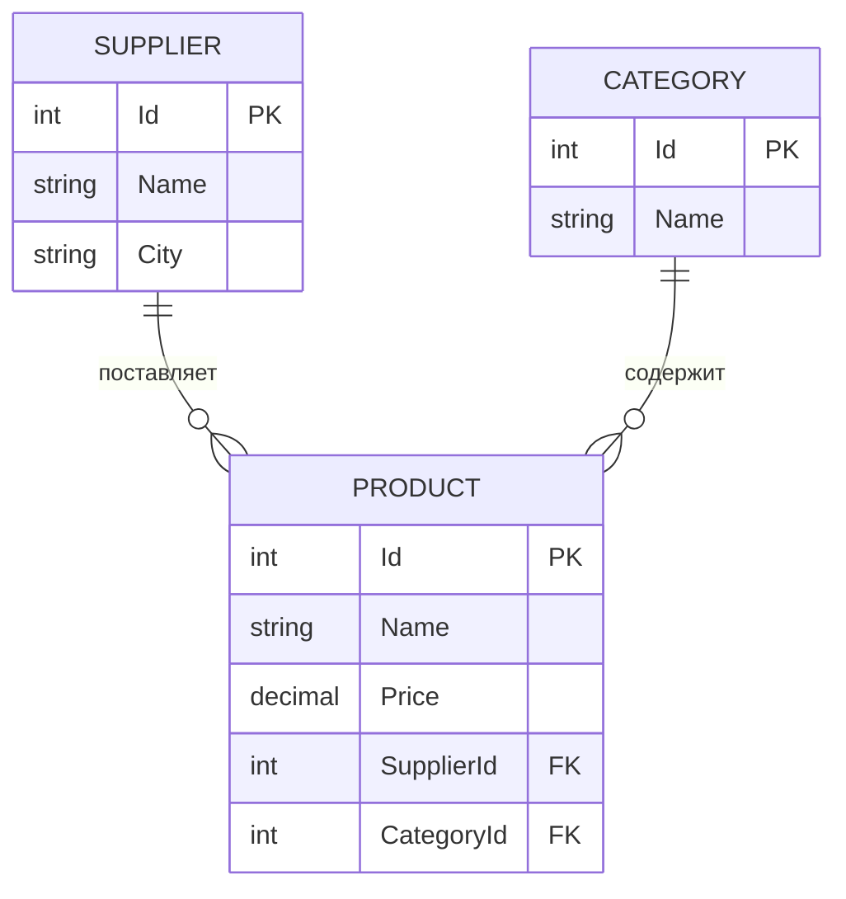

# ProductWebAPI


[](LICENSE.txt)

REST API на ASP.NET Core для управления каталогом товаров. В базе три связанные сущности: **поставщики** (Supplier), **категории** (Category) и **товары** (Product).
Сервис поддерживает полный набор операций CRUD, частичное обновление через JSON Patch и выборку товаров по категории или поставщику. API документирован в Swagger UI.

## Возможности

- **20 эндпоинтов** с полным CRUD для трёх сущностей: `GET`, `POST`, `PUT`, `PATCH`, `DELETE`.
- **Частичное обновление** через JSON Patch ([RFC 6902](https://datatracker.ietf.org/doc/html/rfc6902)) с помощью `JsonPatchDocument<T>`.
- **DTO отделены от сущностей EF Core**: в запросах используются `*Request`, в ответах `*Response`. Клиент не может задать `id` при создании объекта, а навигационные свойства не попадают в ответ.
- **Валидация входных данных** через Data Annotations (`[Required]`, `[Range]`). Если данные некорректны, `[ApiController]` автоматически возвращает `400 Bad Request`.
- **Проверка ссылочной целостности**: при создании и обновлении товара API проверяет, что указанные поставщик и категория существуют. Если какой-то из них не найден, возвращается `404`.
- **Фильтрация** товаров по категории и по поставщику.
- **Асинхронный доступ к данным**: все запросы к БД асинхронные, списки отдаются потоком через `IAsyncEnumerable<T>`.
- **EF Core Code First**: схема БД описана миграциями. Для внешних ключей настроено каскадное удаление, для цены используется тип `decimal(8, 2)`.
- **Готовая база при первом запуске**: в окружении `Development` миграции применяются автоматически, а пустая БД заполняется тестовыми данными.
- **Swagger UI** генерируется из XML-комментариев к контроллерам. Для каждого метода в нём есть примеры запросов и ответов и описание кодов ответа.

## Стек технологий

| Категория | Технологии |
|---|---|
| Платформа | .NET 7, C# (nullable reference types) |
| Веб-фреймворк | ASP.NET Core Web API (контроллеры) |
| Доступ к данным | Entity Framework Core 7, миграции Code First |
| База данных | Microsoft SQL Server (по умолчанию LocalDB) |
| Сериализация | Newtonsoft.Json, ASP.NET Core JSON Patch |
| Документация | Swashbuckle.AspNetCore 6.5 (Swagger / OpenAPI 3) |

## Структура проекта

```
ProductWebAPI.sln
WebAPI/
├── Controllers/
│   ├── CategoriesController.cs               # /api/categories
│   ├── ProductsController.cs                 # /api/products
│   └── SuppliersController.cs                # /api/suppliers
├── Models/
│   ├── Category.cs, Product.cs, Supplier.cs  # сущности EF Core
│   ├── *Request.cs, *Response.cs             # DTO для запросов и ответов
│   ├── ProductContext.cs                     # DbContext
│   └── SeedData.cs                           # применение миграций и тестовые данные
├── Migrations/                               # миграции EF Core
├── Properties/launchSettings.json            # профили запуска (порт 5000)
├── appsettings.json                          # строка подключения к БД
└── Program.cs                                # регистрация сервисов, Swagger, маршрутизация
```

## Модель данных



| Сущность | Поле (JSON) | Тип | Ограничения |
|---|---|---|---|
| **Supplier** | `id` | int | первичный ключ |
| | `name` | string | обязательное |
| | `city` | string | обязательное |
| **Category** | `id` | int | первичный ключ |
| | `name` | string | обязательное |
| **Product** | `id` | int | первичный ключ |
| | `name` | string | обязательное |
| | `price` | decimal(8, 2) | от 1 до 100 000 |
| | `supplierId` | int | внешний ключ на `Supplier`, ≥ 1 |
| | `categoryId` | int | внешний ключ на `Category`, ≥ 1 |

При удалении поставщика или категории все связанные с ними товары удаляются каскадно.

## Быстрый старт

### Требования

- [.NET 7 SDK](https://dotnet.microsoft.com/download/dotnet/7.0)
- SQL Server: LocalDB (устанавливается вместе с Visual Studio) или SQL Server в Docker

### Вариант 1. Windows + LocalDB

```bash
git clone https://github.com/KonstantinUsikov/ProductWebAPI.git
cd ProductWebAPI
dotnet run --project WebAPI
```

Строка подключения по умолчанию задана в `WebAPI/appsettings.json`:

```json
"ConnectionStrings": {
  "ProductConnection": "Data Source=(localdb)\\MSSQLLocalDB;Initial Catalog=ProductDB"
}
```

### Вариант 2. Любая ОС + SQL Server в Docker

Запустите SQL Server в контейнере:

```bash
docker run -d --name productdb-sql \
  -e "ACCEPT_EULA=Y" -e "MSSQL_SA_PASSWORD=Your_Strong_Passw0rd" \
  -p 1433:1433 mcr.microsoft.com/mssql/server:2022-latest
```

Переопределите строку подключения через переменную окружения и запустите приложение.

bash:

```bash
export ConnectionStrings__ProductConnection="Server=localhost,1433;Database=ProductDB;User Id=sa;Password=Your_Strong_Passw0rd;TrustServerCertificate=True"
dotnet run --project WebAPI
```

PowerShell:

```powershell
$env:ConnectionStrings__ProductConnection = "Server=localhost,1433;Database=ProductDB;User Id=sa;Password=Your_Strong_Passw0rd;TrustServerCertificate=True"
dotnet run --project WebAPI
```

### Что происходит при запуске

Сервис запускается по адресу `http://localhost:5000`. Профиль запуска задаёт окружение `Development`, поэтому при старте:

1. автоматически применяются миграции, и выполнять `dotnet ef database update` вручную не нужно;
2. если таблицы пустые, они заполняются тестовыми данными: 3 категории, 5 поставщиков и 5 товаров.

## Документация API

- Swagger UI: http://localhost:5000/swagger
- Спецификация OpenAPI: http://localhost:5000/swagger/v1/swagger.json

## Эндпоинты

### Поставщики: `/api/suppliers`

| Метод | Маршрут | Описание |
|---|---|---|
| `GET` | `/api/suppliers` | Список всех поставщиков |
| `GET` | `/api/suppliers/{id}` | Поставщик по id |
| `POST` | `/api/suppliers` | Создать поставщика |
| `PUT` | `/api/suppliers` | Обновить поставщика (id передаётся в теле) |
| `PATCH` | `/api/suppliers/{id}` | Частично обновить поставщика (JSON Patch) |
| `DELETE` | `/api/suppliers/{id}` | Удалить поставщика вместе с его товарами |

### Категории: `/api/categories`

| Метод | Маршрут | Описание |
|---|---|---|
| `GET` | `/api/categories` | Список всех категорий |
| `GET` | `/api/categories/{id}` | Категория по id |
| `POST` | `/api/categories` | Создать категорию |
| `PUT` | `/api/categories` | Обновить категорию (id передаётся в теле) |
| `PATCH` | `/api/categories/{id}` | Частично обновить категорию (JSON Patch) |
| `DELETE` | `/api/categories/{id}` | Удалить категорию вместе с её товарами |

### Товары: `/api/products`

| Метод | Маршрут | Описание |
|---|---|---|
| `GET` | `/api/products` | Список всех товаров |
| `GET` | `/api/products/{id}` | Товар по id |
| `GET` | `/api/products/category/{id}` | Товары указанной категории |
| `GET` | `/api/products/supplier/{id}` | Товары указанного поставщика |
| `POST` | `/api/products` | Создать товар |
| `PUT` | `/api/products` | Обновить товар (id передаётся в теле) |
| `PATCH` | `/api/products/{id}` | Частично обновить товар (JSON Patch) |
| `DELETE` | `/api/products/{id}` | Удалить товар |

### Коды ответов

| Код | Когда возвращается |
|---|---|
| `200 OK` | Запрос выполнен. `POST`, `PUT`, `PATCH` и `DELETE` возвращают созданный, изменённый или удалённый объект |
| `400 Bad Request` | id в маршруте не является числом или тело запроса не прошло валидацию |
| `404 Not Found` | Объект с указанным id не найден. Для товаров этот код возвращается и тогда, когда не найден указанный поставщик или категория |
| `500 Internal Server Error` | Тело `PATCH`-запроса не удалось применить к объекту |

## Примеры запросов

Примеры написаны для bash. В Windows удобнее выполнить те же запросы прямо из Swagger UI.

Создать товар:

```bash
curl -X POST http://localhost:5000/api/products \
  -H "Content-Type: application/json" \
  -d '{"name": "Видеокарта Asus GeForce GT 1030", "price": 8990.00, "supplierId": 1, "categoryId": 1}'
```

Ответ:

```json
{
  "id": 6,
  "name": "Видеокарта Asus GeForce GT 1030",
  "price": 8990.00,
  "supplierId": 1,
  "categoryId": 1
}
```

Получить все товары категории:

```bash
curl http://localhost:5000/api/products/category/1
```

Обновить поставщика целиком:

```bash
curl -X PUT http://localhost:5000/api/suppliers \
  -H "Content-Type: application/json" \
  -d '{"id": 2, "name": "TESCOMA", "city": "Moscow"}'
```

Частично обновить товар через JSON Patch:

```bash
curl -X PATCH http://localhost:5000/api/products/2 \
  -H "Content-Type: application/json-patch+json" \
  -d '[{"op": "replace", "path": "name", "value": "Видеокарта MSI GeForce GT 1030"}, {"op": "replace", "path": "price", "value": 7490}]'
```

Удалить категорию вместе со всеми её товарами:

```bash
curl -X DELETE http://localhost:5000/api/categories/2
```
